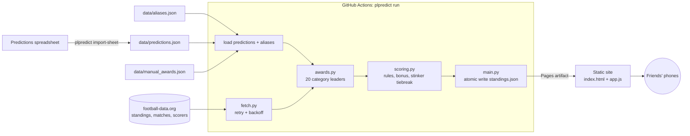

# Premier League Predictions Tracker

A live points table for a friends' 2026/27 Premier League prediction league, styled like Ceefax page 302.

## Executive summary

Before the season, nine friends each predicted the final table and 20 season awards in a shared spreadsheet. This project scores those predictions against the **live** Premier League table, so everyone can see who would win if the season ended today.

- **Scoring engine.** It covers exact positions, champion, top 5, relegation, 6th and 7th, one-off points in 8th to 17th, a most-exact bonus and 20 award categories. Ties are broken by "stinkers": everyone's worst miss is compared, then the next worst, and so on.
- **Live data.** It uses the free [football-data.org](https://www.football-data.org/) API: the table, results and top scorers. Awards with no free data source are entered by hand.
- **Zero cost to run.** A GitHub Actions schedule rescores every 15 minutes during kick-off windows and publishes a static site to GitHub Pages. The API token never reaches the browser.
- **Tested.** There are 146 unit tests (Python `unittest`). The spec's worked examples are encoded as tests, and failures in every external dependency are mocked.

## Quick start

**Prerequisites:** Python 3.11+, and a free API token from [football-data.org](https://www.football-data.org/client/register).

```bash
git clone https://github.com/suhulkebede-git/premier-league-predictions.git
cd premier-league-predictions
python -m pip install -e .

# Run the tests
python -m unittest discover -s tests -t .

# Score everyone against the live table and preview the site
export FOOTBALL_DATA_TOKEN=your-token
plpredict run                      # writes site/standings.json
python -m http.server -d site 8000 # open http://localhost:8000
```

**Deploying your own copy**

1. In the repo, go to **Settings → Secrets and variables → Actions** and add `FOOTBALL_DATA_TOKEN`.
2. Go to **Settings → Pages** and set the source to **GitHub Actions**.
3. Go to **Actions → Update standings → Run workflow** for the first publish. After that it runs on its own.

**Day-to-day upkeep**

| Task | How |
| --- | --- |
| Record a hand-entry award (PFA Player, first sacking, red cards, final-day relegation) | Edit `data/manual_awards.json` and push. Any spelling in `data/aliases.json` works. |
| Re-import the spreadsheet | `plpredict import-sheet predictions.xlsx`. Unknown names are listed with a suggested match; confirm them in `data/aliases.json`. |
| Force an update | **Actions → Update standings → Run workflow** |

## Architecture



| Module | Responsibility |
| --- | --- |
| `predictions.py` | Parses the spreadsheet layout (two person blocks per band, every 24 rows from row 26) and validates each person's 20 unique clubs and 20 award picks |
| `names.py` | Normalises spellings ("Manchester Yanited", "Big Erl") through confirmed aliases and suggests matches for unknown names |
| `fetch.py` | football-data.org v4 client; retries 429/5xx and fails fast on auth errors |
| `awards.py` | Current leader(s) of each award: live table stats, points-pace change vs last season, a Christmas table rebuilt from results, and over-90/under-25 locked once mathematically decided |
| `scoring.py` | Pure scoring and ranking, with no I/O |
| `main.py` | CLI entry points; writes output via temp file + rename so a failed run never leaves a partial file |
| `site/` | Vanilla HTML/CSS/JS with no build step; reads only `standings.json` |

Design decisions:

- **Scoring is pure.** Only `fetch.py` touches the network, so every rule is tested without the API.
- **Picks are normalised once.** Every club, player and answer spelling maps to one canonical value at import time, and the import fails loudly on anything unmapped. A typo can't silently cost someone points.
- **A failed run never deploys.** The last good standings stay live, and GitHub emails the failure.
- **Standings are published as a Pages artifact, not committed.** This keeps about 50 automated commits a day out of the history.

## Scrum & methodology

The work followed a spec-first, small-increment process. Suhul Kebede acted as product owner and Claude (Anthropic's AI assistant) as the implementing engineer.

1. **Requirements and rules.** The group's informal rules were turned into precise questions: what stacks, what's all-or-nothing, and how edge cases score. Suhul answered each one and made the rulings, for example:
   - an exact title margin only
   - live points-pace for biggest increase
   - a goalkeeper pick counts as his club
   - Ugwe's "Crystal Palace or Brighton" pick scores Palace only, with Brighton as a tiebreak
2. **Technical spec and sign-off.** No code was written until a spec was approved: scope, scoring rules with worked examples, all 20 awards with data sources, data structures, architecture, interfaces, performance limits and risks. When the real spreadsheet showed 20 award categories rather than a few, the spec was revised and re-approved before that work started.
3. **Backlog.** The approved spec was split into nine tasks. Each has acceptance criteria and maps to one reviewable commit, with its tests in the same commit so every commit stays green. Progress was tracked task by task, in order:

   | # | Task | Commit |
   | --- | --- | --- |
   | 1 | Scaffold the repo | `chore: scaffold Python package, logging and test layout` |
   | 2 | Import predictions from the sheet | `feat(predictions): import and validate the group's prediction sheet` |
   | 3 | Score per-person rules | `feat(scoring): score the finishing-order rules` |
   | 4 | Bonus, awards, tiebreak and ranking | `feat(scoring): add award points, most-exact bonus and ranking` |
   | 5 | Fetch live data | `feat(fetch): add football-data.org client and award resolution` |
   | 6 | Build the pipeline entry point | `feat(main): add scheduled run and sheet import entry points` |
   | 7 | Build the frontend | `feat(web): add teletext-style static site` |
   | 8 | Schedule and deploy | `ci: schedule standings updates and deploy to GitHub Pages` |
   | 9 | Write the README | `docs: add README` |

4. **Definition of done.** For each task:
   - explicit error handling with specific exception types
   - standard-library logging rather than prints
   - unit tests covering happy paths, boundaries, invalid input and mocked dependency failures
   - [Conventional Commits](https://www.conventionalcommits.org/) messages
5. **Verification.** The real spreadsheet was parsed end to end. All 9 people's predictions validated, and every non-exact name mapping was confirmed by Suhul. The site was checked in a headless browser at phone and desktop widths.

## Data notes

- Last season's points and this season's club list come from the spreadsheet (A3:B22 and C3:C22). The promoted clubs are inferred as Coventry City, Hull City and Ipswich Town.
- Red cards and bookings aren't on football-data.org's free tier, so "Club with Most Red Cards" is a hand entry.
- The scorers endpoint ranks players by goals. The tracker requests the top 200 so that assist leaders with few goals are included.
