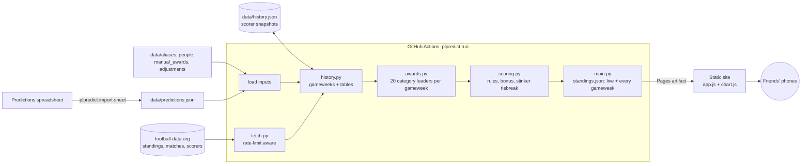

# Premier League Predictions Tracker

A live points table and season history for a friends' 2026/27 Premier League prediction league, as a dark sports dashboard.

## Executive summary

Before the season, nine friends each predicted the final table and 20 season awards in a shared spreadsheet. This project scores those predictions against the **live** Premier League table, so everyone can see who would win if the season ended today. It also shows how the race has moved, gameweek by gameweek.

- **Scoring engine.** It covers exact positions, champion, top 5, relegation, 6th and 7th, one-off points in 8th to 17th, a most-exact bonus and 20 award categories. Ties are broken by "stinkers": everyone's worst miss is compared, then the next worst, and so on.
- **Gameweek history.** Every finished gameweek's standings are rebuilt from match results: the table, the awards and everyone's points. You can step back to any gameweek, see up/down movement arrows, and follow a rank-by-gameweek bump chart.
- **Live data.** It uses the free [football-data.org](https://www.football-data.org/) API: the table, results and scorers. Awards with no free data source are entered by hand.
- **Zero cost to run.** A GitHub Actions schedule rescores every 15 minutes during kick-off windows and publishes a static site to GitHub Pages. The API token never reaches the browser.
- **Tested.** There are 242 unit tests (Python `unittest`). The spec's worked examples are encoded as tests, and failures in every external dependency are mocked.

## Quick start

**Prerequisites:** Python 3.11+, and a free API token from [football-data.org](https://www.football-data.org/client/register). Verify the account email: a new token can be rejected as invalid until you do.

```bash
git clone https://github.com/suhulkebede-git/premier-league-predictions.git
cd premier-league-predictions
python -m pip install -e .

# Run the tests
python -m unittest discover -s tests -t .

# Score everyone against the live table and preview the site
export FOOTBALL_DATA_TOKEN=your-token
plpredict run                      # writes site/standings.json (and data/history.json)
python -m http.server -d site 8000 # open http://localhost:8000
```

**Deploying your own copy**

1. In the repo, go to **Settings → Secrets and variables → Actions** and add `FOOTBALL_DATA_TOKEN`. Paste only the 32-character token.
2. Go to **Settings → Pages** and set the source to **GitHub Actions**.
3. Go to **Actions → Update standings → Run workflow** for the first publish. After that it runs on its own.

**Day-to-day upkeep**

| Task | How |
| --- | --- |
| Record a hand-entry award (PFA Player, first sacking, red cards, final-day relegation) | Edit `data/manual_awards.json`: set `leaders`, `settled` once it's final, and `from_gameweek` to the gameweek it happened in. Any spelling in `data/aliases.json` works. |
| Record a points deduction | Add `{"club", "points": -6, "from_gameweek", "reason"}` to `data/adjustments.json`. Earlier gameweeks stay as they were. |
| Change someone's display name or initials | Edit `data/people.json` |
| Re-import the spreadsheet | `plpredict import-sheet predictions.xlsx`. Unknown names are listed with a suggested match; confirm them in `data/aliases.json`. |
| Force an update | **Actions → Update standings → Run workflow** |
| A run failed | Open the failed run: its summary shows the reason, such as an invalid token (with a fingerprint of the token in use) or an unknown team name. |

## Architecture



| Module | Responsibility |
| --- | --- |
| `predictions.py` | Parses the spreadsheet layout (two person blocks per band, every 24 rows from row 26) and validates each person's 20 unique clubs and 20 award picks |
| `names.py` | Normalises spellings ("Manchester Yanited", "Big Erl") through confirmed aliases and suggests matches for unknown names |
| `fetch.py` | football-data.org v4 client: reads the rate-limit headers, retries 429/5xx, and fails fast with the API's own message on auth errors |
| `history.py` | Assigns each match to a gameweek (postponed games count where they're played), finds finished and in-progress gameweeks, rebuilds the table after any gameweek with deductions, and keeps scorer history |
| `awards.py` | Leader(s) of each award, live or as of a gameweek: table stats, points-pace change vs last season, a Christmas table rebuilt from results, over-90/under-25 locked once mathematically decided, and hand entries from their gameweek |
| `scoring.py` | Pure scoring and ranking, with no I/O |
| `main.py` | CLI entry points; checks the token's shape, writes compact output via temp file + rename, and surfaces failures as GitHub annotations |
| `site/` | Vanilla HTML/CSS/JS with no build step; the bump chart is hand-drawn SVG; reads only `standings.json` |

Design decisions:

- **Scoring is pure.** Only `fetch.py` touches the network, so every rule is tested without the API. History reuses the same `score_all`, once per gameweek.
- **History is rebuilt, not stored.** Past tables come from match results on every run, so only goal and assist leaders need saving: `data/history.json` changes about once per gameweek.
- **Picks are normalised once.** Every club, player and answer spelling maps to one canonical value at import time, and the import fails loudly on anything unmapped. A typo can't silently cost someone points.
- **A failed run never deploys.** The last good standings stay live, and GitHub emails the failure.
- **Standings are published as a Pages artifact, not committed.** This keeps about 50 automated commits a day out of the history.
- **Colour is never the only identity.** Each person's colour comes from a palette validated for colour-blind separation on the dark background. Because nine lines can't all be separated where they cross, every line also ends in the person's initials and name.

## Scrum & methodology

The work followed a spec-first, small-increment process. Suhul Kebede acted as product owner and Claude (Anthropic's AI assistant) as the implementing engineer.

1. **Requirements and rules.** The group's informal rules were turned into precise questions: what stacks, what's all-or-nothing, and how edge cases score. Suhul answered each one and made the rulings, for example:
   - an exact title margin only
   - live points-pace for biggest increase
   - a goalkeeper pick counts as his club
   - Ugwe's "Crystal Palace or Brighton" pick scores Palace only, with Brighton as a tiebreak
   - postponed games count in the gameweek they're played
   - deductions count from the gameweek they happen
2. **Technical spec and sign-off.** No code was written until a spec was approved. The spec covered scope, scoring rules with worked examples, data sources, data structures, architecture, interfaces, performance limits and risks. When the real spreadsheet showed 20 award categories, the spec was revised and re-approved, and v2 got its own spec and sign-off.
3. **Backlog.** Each approved spec was split into tasks with acceptance criteria. Each task maps to one reviewable commit, with its tests in the same commit so every commit stays green.

   **v1: live tracker (PR #1)**

   | # | Task | Commit |
   | --- | --- | --- |
   | 1 | Scaffold the repo | `chore: scaffold Python package, logging and test layout` |
   | 2 | Import predictions from the sheet | `feat(predictions): import and validate the group's prediction sheet` |
   | 3 | Score per-person rules | `feat(scoring): score the finishing-order rules` |
   | 4 | Bonus, awards, tiebreak and ranking | `feat(scoring): add award points, most-exact bonus and ranking` |
   | 5 | Fetch live data | `feat(fetch): add football-data.org client and award resolution` |
   | 6 | Build the pipeline entry point | `feat(main): add scheduled run and sheet import entry points` |
   | 7 | Build the frontend | `feat(web): add teletext-style static site` |
   | 8 | Schedule and deploy | `ci: schedule standings updates and deploy to GitHub Pages` |
   | 9 | Write the README | `docs: add README` |

   **Launch fixes (PRs #2, #3).** The first live run failed, and its log only said "HTTP 400". Three fixes made the cause findable: errors became visible on the run summary, the API's own message was included, and a safe token fingerprint was logged. Together they showed an unverified-account token, which was fixed on football-data.org's side.

   **v2: dashboard and history**

   | # | Task | Commit |
   | --- | --- | --- |
   | 10 | Rebuild standings for every gameweek | `feat(history): rebuild the league table after any gameweek` |
   | 11 | Award history and scorer snapshots | `feat(history): resolve awards for past gameweeks with scorer history` |
   | 12 | Pipeline output and workflow commit | `feat(main): publish every gameweek's standings and commit scorer history`, `perf(main): write standings.json compactly` |
   | 13–14 | Dashboard restyle; gameweek control, arrows and last-updated | `feat(web): neon dashboard restyle with gameweek control and arrows` |
   | 15 | Ranking chart | `feat(web): add the rank-by-gameweek bump chart` |
   | 16 | Update the README | `docs: update README for v2` |

4. **Definition of done.** For each task:
   - explicit error handling with specific exception types
   - standard-library logging rather than prints
   - unit tests covering happy paths, boundaries, invalid input and mocked dependency failures
   - [Conventional Commits](https://www.conventionalcommits.org/) messages
5. **Verification.**
   - The real spreadsheet was parsed end to end, and every non-exact name mapping was confirmed by Suhul.
   - The v2 site was built against a nine-gameweek demo and checked in a headless browser at phone and desktop widths, including chart taps, gameweek navigation and fallbacks.

## Data notes

- Last season's points and this season's club list come from the spreadsheet (A3:B22 and C3:C22). The promoted clubs are inferred as Coventry City, Hull City and Ipswich Town.
- A gameweek's "window" is its fixtures within 4 days of the median kick-off. Only a match played outside its own window moves to the nearest other gameweek, so a Monday game next to a Tuesday round stays put.
- Golden Boot and Top Assister history comes from snapshots of the live scorers list, taken between gameweeks (when it equals the totals through the last finished gameweek). The API's `matchday` filter on scorers turned out to be ignored: it returns today's totals for any gameweek. The tracker detects this (more goals listed than had been scored by then) and discards those results, so gameweeks before snapshots began show these two awards as "not recorded".
- Red cards and bookings aren't on football-data.org's free tier, so "Club with Most Red Cards" is a hand entry.
- The scorers endpoint ranks players by goals. The tracker requests the top 200 so that assist leaders with few goals are included.
- The live view uses the API's own table, which already includes any points deductions. Rebuilt past tables rank by points, goal difference, then goals scored.
